# nos.tlplotR

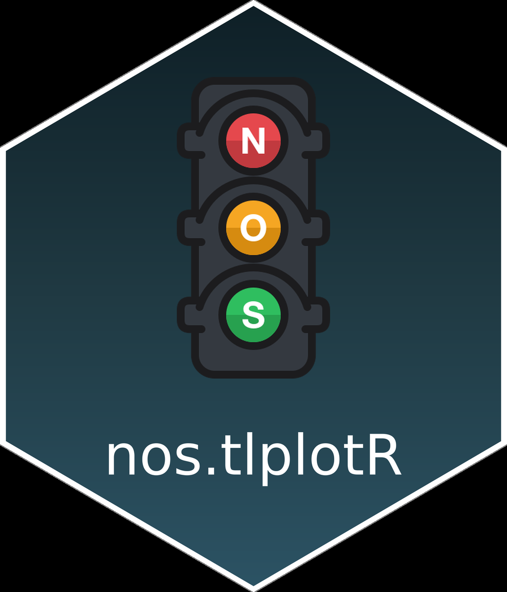

<!-- badges: start -->
[](https://doi.org/10.5281/zenodo.24380517)
<!-- badges: end -->

**nos.tlplotR** is an open-source **R package** for visualizing **Newcastle-Ottawa Scale (NOS) risk-of-bias assessments** in systematic reviews and meta-analyses — the official R interface to [**nos-tlplot**](https://nos-tlplot.github.io). It produces **publication-ready traffic-light plots** and **thirteen specialized visualizations**:

| Function | Plot |
|---|---|
| `plot_nos_visualization()` | NOS visualization grid (item-level traffic-light grid with domain bands and totals) |
| `plot_traffic_light()` | Classic traffic-light bubble plot |
| `plot_domain_radar()` | Domain radar chart (up to 5 studies) |
| `plot_theme_radar()` | Theme radar chart (up to 5 studies) |
| `plot_domain_heatmap()` | Domain-level risk heatmap |
| `plot_item_heatmap()` | Item-level star heatmap with domain bands |
| `plot_dot_profile()` | Stacked domain stars per study |
| `plot_score_table()` | Summary table of stars and overall risk |
| `plot_donut()` | Risk donut chart per domain |
| `plot_star_matrix()` | Item-level star ratings matrix |
| `plot_lollipop()` | Total score lollipop chart |
| `plot_risk_pie()` | Overall risk-of-bias pie chart |
| `plot_stacked_area()` | Stacked area risk chart |

---

## Contents

1. [Installation](#installation)
2. [Python setup](#python-setup)
3. [Quick start](#quick-start)
4. [See it in action](#see-it-in-action)
5. [How to use nos.tlplotR in R](#how-to-use-nostlplotr-in-r)
6. [Input data reference](#input-data-reference)
7. [Themes and output formats](#themes-and-output-formats)
8. [Return values](#return-values)
9. [Seeing the Python messages](#seeing-the-python-messages)
10. [Using plots in R Markdown and Quarto](#using-plots-in-r-markdown-and-quarto)
11. [Bundled example data](#bundled-example-data)
12. [Troubleshooting](#troubleshooting)
13. [Example gallery](#example-gallery)
14. [Citation](#citation)
15. [Related links](#related-links)

---

## Installation

### From CRAN

```r
install.packages("nos.tlplotR")
```

### Development version from GitHub

```r
# install.packages("pak")
pak::pak("nos-tlplot/nos.tlplotR")

# or
# install.packages("remotes")
remotes::install_github("nos-tlplot/nos.tlplotR")
```

### From a source tarball

```r
install.packages("nos.tlplotR_0.2.0.tar.gz", repos = NULL, type = "source")
```

### Install the Python backend manually

`nos.tlplotR` calls the Python package `nos-tlplot`. If you prefer to manage
Python yourself, install it into the interpreter that reticulate uses:

```r
reticulate::py_install("nos-tlplot", pip = TRUE)
```

or from a terminal:

```bash
pip install "nos-tlplot>=3.0.2"
```

## Python setup

`nos.tlplotR` requires **Python >= 3.12** and **nos-tlplot >= 3.0.2**. The
version is a minimum: `pip` installs the newest release that satisfies it.
You have three options.

### Option 1: Let reticulate manage Python (easiest)

On load, `nos.tlplotR` declares its Python dependency with
`reticulate::py_require("nos-tlplot>=3.0.2")`. If no other Python
installation is found, reticulate creates a managed environment and installs
`nos-tlplot` (plus `numpy`, `pandas`, `matplotlib`, `seaborn`, `pyarrow`,
`openpyxl` and `Pillow`) the first time you create a plot. The first call
therefore takes a few minutes; later calls are fast because the environment
is cached.

```r
library(nos.tlplotR)
plot_nos_visualization(system.file("extdata", "sample_nos.csv", package = "nos.tlplotR"), "nos.png")
```

### Option 2: Use an existing virtual environment or conda environment

```r
reticulate::virtualenv_create("nos-tlplot-env", packages = "nos-tlplot")
reticulate::use_virtualenv("nos-tlplot-env", required = TRUE)

# or
reticulate::conda_create("nos-tlplot-env", packages = "nos-tlplot")
reticulate::use_condaenv("nos-tlplot-env", required = TRUE)
```

Call `use_virtualenv()` / `use_condaenv()` **before** the first plot call in
the session.

### Option 3: Use a specific system Python

```r
Sys.setenv(RETICULATE_PYTHON = "/path/to/python3")
```

To make this permanent, add the same line to your `~/.Renviron`, then restart R.
Alternatively use `reticulate::use_python("/path/to/python3", required = TRUE)`.

### Verify the setup

```r
reticulate::py_config()                      # which interpreter is used
reticulate::py_module_available("nos_tlplot") # must be TRUE
```

`py_config()` also prints the versions of Python and reticulate that you
should include when reporting a problem.

If Python itself is missing, reticulate can install one:

```r
reticulate::install_python()
```

## Quick start

```r
library(nos.tlplotR)

# Create the NOS visualization plot from the bundled example file
out <- plot_nos_visualization(
  input_file  = system.file("extdata", "sample_nos.csv", package = "nos.tlplotR"),
  output_file = "nos.png"
)

out
#> [1] "/path/to/nos.png"
```

Open `nos.png` with any image viewer, or inside R:

```r
utils::browseURL(out)
```

## See it in action

Each plot below was created by a live R session from the bundled example
data. The console shows the exact calls; the figure underneath is the file
the function returned.

<figure>
  
  <figcaption><strong>NOS visualization grid</strong> — <code>plot_nos_visualization()</code>: item-level traffic-light grid with domain bands, totals and overall judgements.</figcaption>
</figure>

<figure>
  
  <figcaption><strong>Traffic-light bubble plot</strong> — <code>plot_traffic_light()</code>.</figcaption>
</figure>

## How to use nos.tlplotR in R

Every plotting function has the same interface:

```r
plot_xxx(input_file, output_file, theme = "traffic_light", verbose = FALSE)
```

* `input_file`: a data frame, or a path to a `.csv`, `.xls`, or `.xlsx` file.
* `output_file`: path for the plot; the extension must be `.png`, `.pdf`,
  `.svg`, or `.tiff`.
* `theme`: colour theme (see [Themes and output
  formats](#themes-and-output-formats)).
* `verbose`: if `TRUE`, print the messages emitted by the Python package.

### Plot from an existing CSV or Excel file

```r
plot_traffic_light(
  input_file  = "my_nos_data.xlsx",
  output_file = "figures/nos.pdf"
)
```

The output directory must already exist. The package never modifies your
input file.

### Plot from a data frame

`input_file` also accepts a data frame, so you can read, filter, or reshape
your data in R and pass it straight to a plotting function. The data frame is
written to a temporary CSV for Python and removed when the call finishes.

```r
# Read a CSV without mangling the column names
dat <- read.csv("my_nos_data.csv", check.names = FALSE)

# Read an Excel file without mangling the column names
dat <- readxl::read_excel("my_nos_data.xlsx", .name_repair = "minimal")

# Inspect the names before plotting
names(dat)

plot_nos_visualization(dat, "nos.png")
```

The same works for a subset of studies, a data frame built from scratch, or a
`tibble`:

```r
low_risk <- subset(dat, `Overall RoB` == "Low")
plot_nos_visualization(low_risk, "nos-low.png")
```

If your column names are already mangled (`Overall.RoB` instead of
`Overall RoB`), rename them first:

```r
names(dat) <- gsub("\\.", " ", names(dat))
# or, for a single column:
names(dat)[names(dat) == "Overall.RoB"] <- "Overall RoB"
```

### Plot all themes in a loop

```r
input <- system.file("extdata", "sample_nos.csv", package = "nos.tlplotR")

for (theme in c("traffic_light", "gray", "ocean", "sage")) {
  plot_nos_visualization(
    input_file  = input,
    output_file = sprintf("nos-%s.png", theme),
    theme       = theme
  )
}
```

### Radar plots and the 5-study limit

Radar charts support at most 5 studies. With more studies no chart is
created; the function prints a message and returns `NULL` invisibly:

```r
res <- plot_domain_radar(input, "radar.png")  # NULL when there are > 5 studies
```

## Input data reference

Use the exact names shown below. Column order does not matter.

| Column | Notes |
|---|---|
| `Author, Year` | One column containing author and year, separated by a comma and space. In a CSV the header must be quoted: `"Author, Year"`. |
| `Representativeness` | Star value, 0-5 |
| `Non-exposed Selection` | Star value, 0-5 |
| `Exposure Ascertainment` | Star value, 0-5 |
| `Outcome Absent at Start` | Star value, 0-5 |
| `Comparability (Age/Gender)` | Star value, 0-5 |
| `Comparability (Other)` | Star value, 0-5 |
| `Outcome Assessment` | Star value, 0-5 |
| `Follow-up Length` | Star value, 0-5 |
| `Follow-up Adequacy` | Star value, 0-5 |
| `Total Score` | Numeric total, 0-9 |
| `Overall RoB` | `"Low"`, `"Moderate"`, or `"High"` |

> 💡 *Tip:* Always include your raw NOS scoring table in supplementary
> materials for reproducibility.

## Themes and output formats

Four colour themes are available on every plot function:

| Theme | Low | Moderate | High |
|---|---|---|---|
| `traffic_light` (default) | `#2E7D32` | `#F9A825` | `#C62828` |
| `gray` | `#D6D6D6` | `#9E9E9E` | `#3C3C3C` |
| `ocean` | `#6BAED6` | `#2171B5` | `#08306B` |
| `sage` | `#63BF93` | `#5B6D80` | `#FF884D` |

Supported output formats are PNG (300 dpi), PDF, SVG, and TIFF (LZW
compressed). Choose the format through the file extension:

```r
input <- system.file("extdata", "sample_nos.csv", package = "nos.tlplotR")

plot_nos_visualization(input, "nos.png")   # raster, 300 dpi
plot_nos_visualization(input, "nos.pdf")   # vector, for manuscripts
plot_nos_visualization(input, "nos.svg")   # vector, for editing or the web
plot_nos_visualization(input, "nos.tiff")  # LZW-compressed, for journal submission
```

## Return values

All functions return the path of the file they created, invisibly. This
makes it easy to chain plotting and reporting:

```r
nos_file <- plot_nos_visualization(
  system.file("extdata", "sample_nos.csv", package = "nos.tlplotR"),
  "nos.png"
)
knitr::include_graphics(nos_file)
```

They also fail early with a clear R error if the input file is missing, the
extension is unsupported, the output directory does not exist, or the theme
name is invalid.

## Seeing the Python messages

`nos-tlplot` prints progress and diagnostic messages (for example, warnings
about total-score mismatches). These are captured by default so that the
functions are silent and work under every locale. Use `verbose = TRUE` to
relay them to the R console:

```r
input <- system.file("extdata", "sample_nos.csv", package = "nos.tlplotR")
plot_traffic_light(input, "nos.png", verbose = TRUE)
```

## Using plots in R Markdown and Quarto

````markdown
```{r}
library(nos.tlplotR)

plot_nos_visualization(
  input_file  = "data/nos.csv",
  output_file = "figures/nos.png"
)
```


````

For a figure caption and automatic sizing, use `knitr::include_graphics()`:

````markdown
```{r, fig.cap = "Risk of bias across studies (NOS)."}
knitr::include_graphics("figures/nos.png")
```
````

## Bundled example data

The package ships with a sample NOS dataset in both formats:

```r
list.files(system.file("extdata", package = "nos.tlplotR"))
```

```text
sample_nos.csv             sample_nos.xlsx
```

Use them as templates for your own data:

```r
input <- system.file("extdata", "sample_nos.xlsx", package = "nos.tlplotR")
plot_nos_visualization(input, "nos.png")
```

## Troubleshooting

### Check the basics first

```r
reticulate::py_config()
reticulate::py_module_available("nos_tlplot")
reticulate::py_run_string("import nos_tlplot; print(nos_tlplot.__file__)")
```

`py_module_available()` must return `TRUE`. If it returns `FALSE`, Python is
either not installed, or the package is installed in a different interpreter
than the one reticulate is using.

### "The 'nos-tlplot' Python package is not available"

Install the module into the interpreter that reticulate uses, then restart R:

```r
reticulate::py_install("nos-tlplot", pip = TRUE)
```

If you use a virtual environment or conda environment, activate it first with
`reticulate::use_virtualenv()` / `reticulate::use_condaenv()`.

### reticulate is using the wrong Python

```r
# Temporary, for this session only
Sys.setenv(RETICULATE_PYTHON = "/path/to/python3")

# Permanent
usethis::edit_r_environ()
# add: RETICULATE_PYTHON=/path/to/python3
```

Restart R after changing `RETICULATE_PYTHON`. On Windows the path often looks
like `C:/Users/you/AppData/Local/Programs/Python/Python312/python.exe`.

### Python is not installed

```r
reticulate::install_python(version = "3.12")
```

Then restart R and check `reticulate::py_config()` again.

### "Missing required columns"

The column names in your file do not match the expected spelling. Common
causes:

* `read.csv()` replaces spaces with dots in column names. Read with
  `check.names = FALSE`, or rename the columns.
* The author column must be one column named `Author, Year`, which has to be
  quoted in a CSV header: `"Author, Year"`.

Print `names(your_data)` and compare it with the
[Input data reference](#input-data-reference).

### XML/Excel errors

Reading `.xlsx` files needs the Python package `openpyxl`. It is installed
automatically with `nos-tlplot`, but if you installed `nos-tlplot` manually:

```r
reticulate::py_install("openpyxl", pip = TRUE)
```

Legacy `.xls` files are converted in R first and need the `readxl` package:

```r
install.packages("readxl")
```

If you do not have `readxl`, save the file as `.xlsx` or `.csv` instead.

### Theme errors

Only `"traffic_light"`, `"gray"`, `"ocean"` and `"sage"` are valid themes.

### "Unsupported output file type"

Use `.png`, `.pdf`, `.svg`, or `.tiff`. Also make sure the output directory
already exists and that you have permission to write to it.

### Plots are slow the first time

The first call may install Python packages into reticulate's managed
environment. Subsequent calls reuse the cached environment. If you are
offline, point reticulate at an interpreter that already has `nos-tlplot`
installed.

### Headless Linux server / no display

Matplotlib may try to open a GUI backend. Force the non-interactive backend
before Python starts:

```r
Sys.setenv(MPLBACKEND = "Agg")
library(nos.tlplotR)
```

### Still stuck?

Open an issue at <https://github.com/nos-tlplot/nos.tlplotR/issues> and include
the output of:

```r
sessionInfo()
reticulate::py_config()
reticulate::py_module_available("nos_tlplot")
```

## Example gallery

The plots below were generated from the bundled example data
(`inst/extdata/`) with the default theme, using this one-liner pattern:

```r
plot_nos_visualization(
  system.file("extdata", "sample_nos.csv", package = "nos.tlplotR"),
  "nos.png"
)
```

### Flagship plots

<figure>
  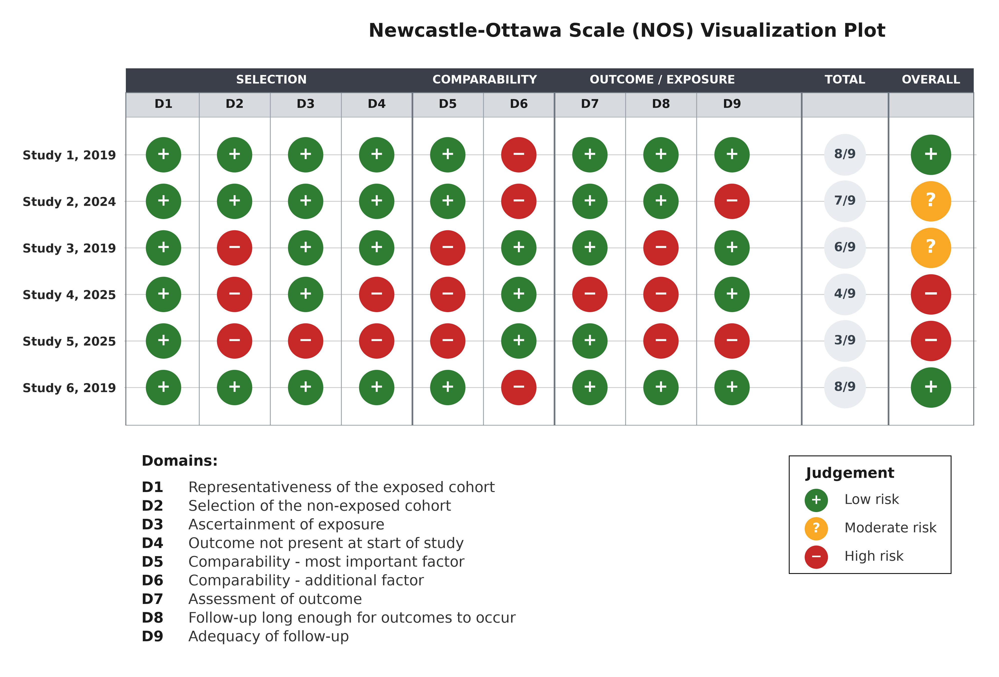
  <figcaption><strong>NOS visualization grid</strong> — <code>plot_nos_visualization()</code>. One row per study, one column per item, plus totals and the overall judgement.</figcaption>
</figure>

<figure>
  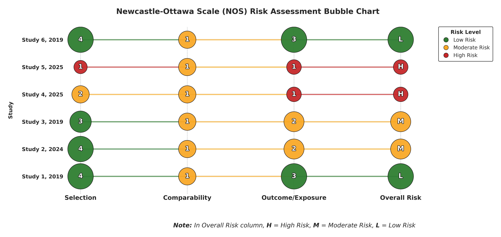
  <figcaption><strong>Traffic-light bubble plot</strong> — <code>plot_traffic_light()</code>. Bubbles are sized by the stars earned and joined across domains.</figcaption>
</figure>

### Domain-level summaries

<figure>
  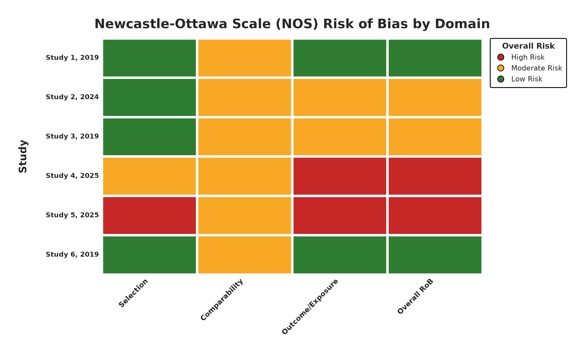
  <figcaption><strong>Domain heatmap</strong> — <code>plot_domain_heatmap()</code>.</figcaption>
</figure>

<figure>
  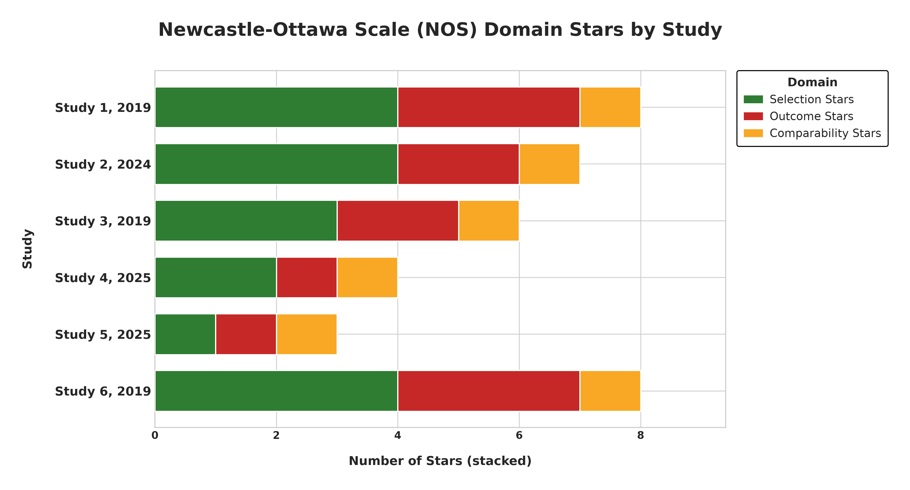
  <figcaption><strong>Stacked domain stars</strong> — <code>plot_dot_profile()</code>.</figcaption>
</figure>

<figure>
  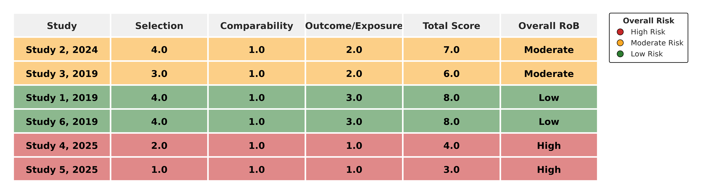
  <figcaption><strong>Score table</strong> — <code>plot_score_table()</code>.</figcaption>
</figure>

<figure>
  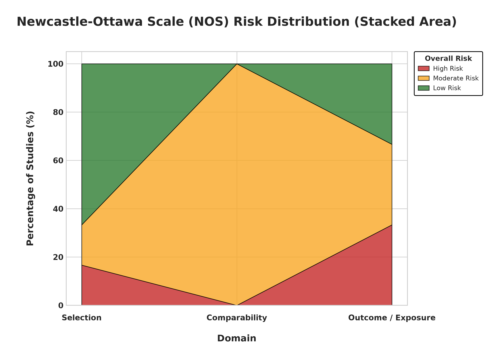
  <figcaption><strong>Stacked area risk chart</strong> — <code>plot_stacked_area()</code>.</figcaption>
</figure>

### Item-level plots

<figure>
  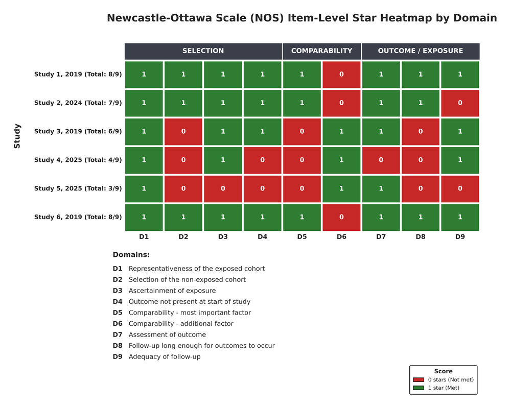
  <figcaption><strong>Item-level star heatmap</strong> — <code>plot_item_heatmap()</code>.</figcaption>
</figure>

<figure>
  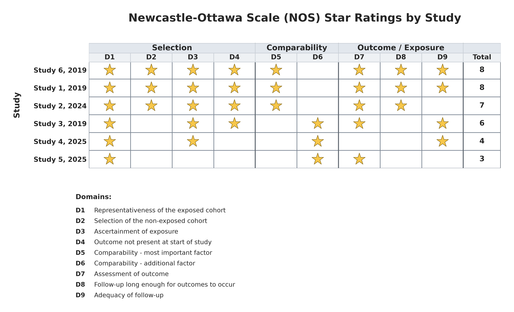
  <figcaption><strong>Star ratings matrix</strong> — <code>plot_star_matrix()</code>.</figcaption>
</figure>

### Distributions

<figure>
  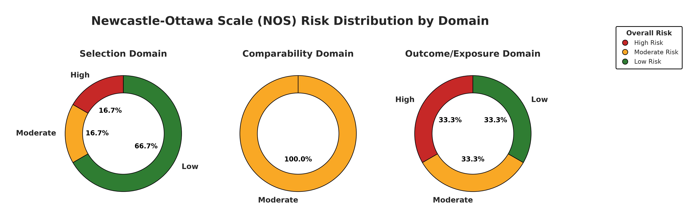
  <figcaption><strong>Risk donut chart</strong> — <code>plot_donut()</code>.</figcaption>
</figure>

<figure>
  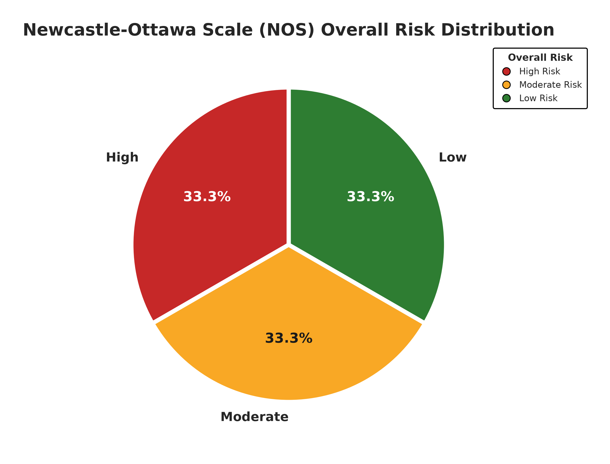
  <figcaption><strong>Overall risk pie</strong> — <code>plot_risk_pie()</code>.</figcaption>
</figure>

<figure>
  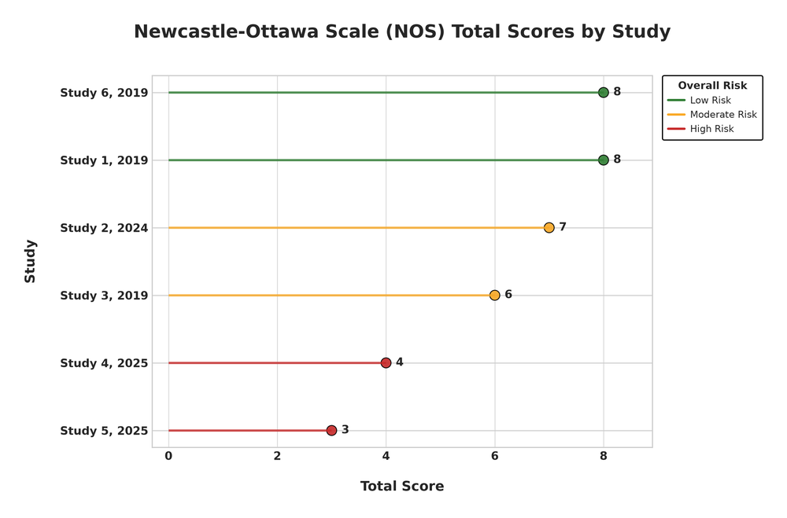
  <figcaption><strong>Total score lollipop</strong> — <code>plot_lollipop()</code>.</figcaption>
</figure>

<figure>
  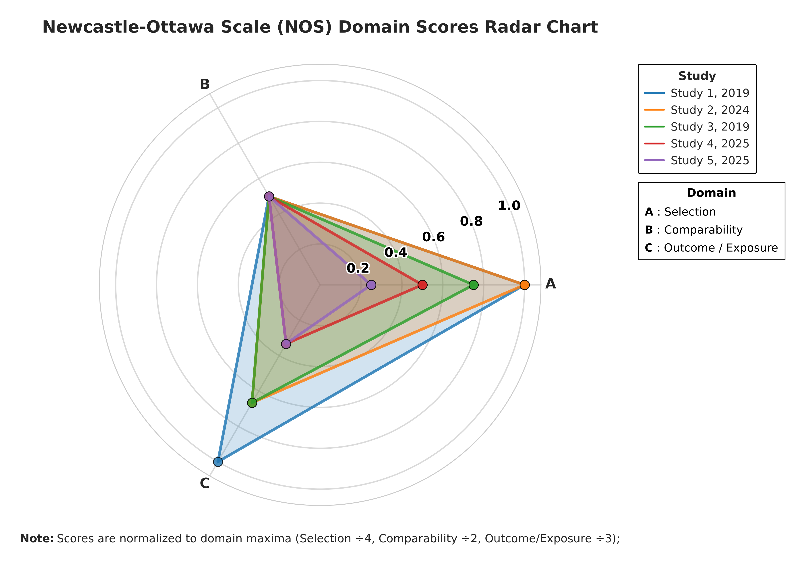
  <figcaption><strong>Domain radar</strong> — <code>plot_domain_radar()</code>. Radar plots support at most 5 studies.</figcaption>
</figure>

<figure>
  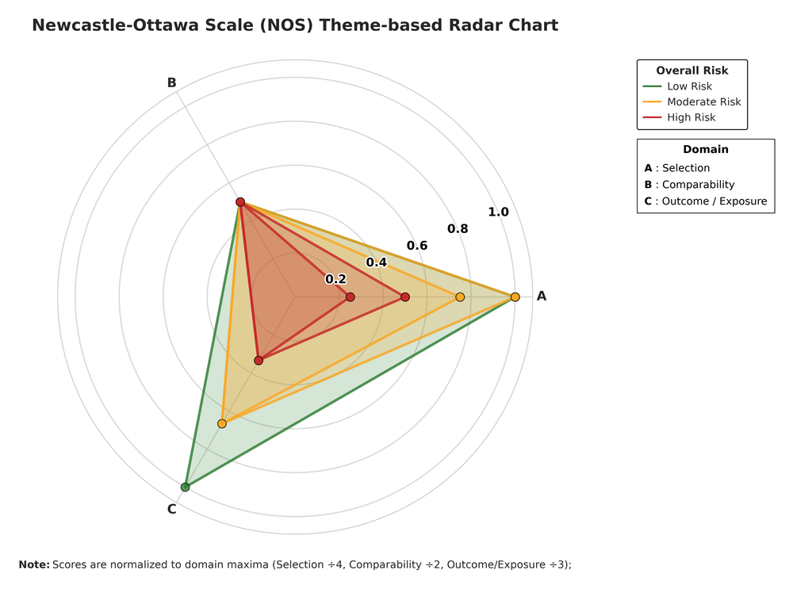
  <figcaption><strong>Theme radar</strong> — <code>plot_theme_radar()</code>.</figcaption>
</figure>

### Theme variants

The same data can be plotted with several colour themes. The NOS
visualization above uses the <code>"traffic_light"</code> theme; here are the
three alternatives:

<figure>
  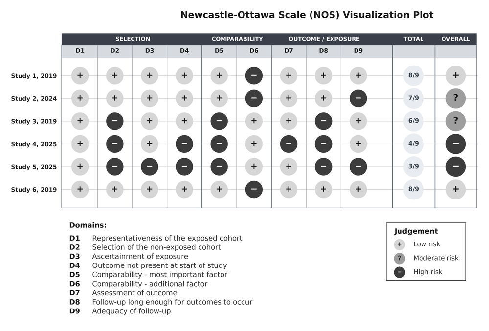
  <figcaption><strong>NOS visualization, <code>"gray"</code> theme</strong> — <code>plot_nos_visualization(..., theme = "gray")</code>.</figcaption>
</figure>

<figure>
  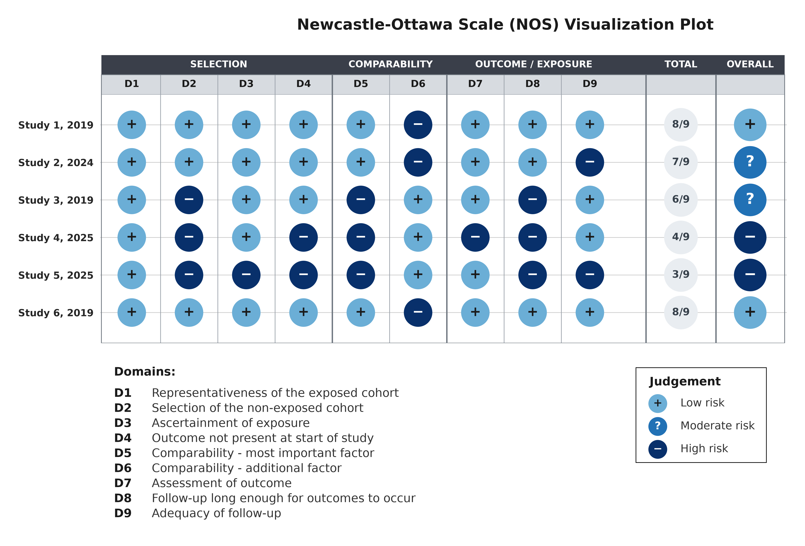
  <figcaption><strong>NOS visualization, <code>"ocean"</code> theme</strong> — <code>plot_nos_visualization(..., theme = "ocean")</code>.</figcaption>
</figure>

<figure>
  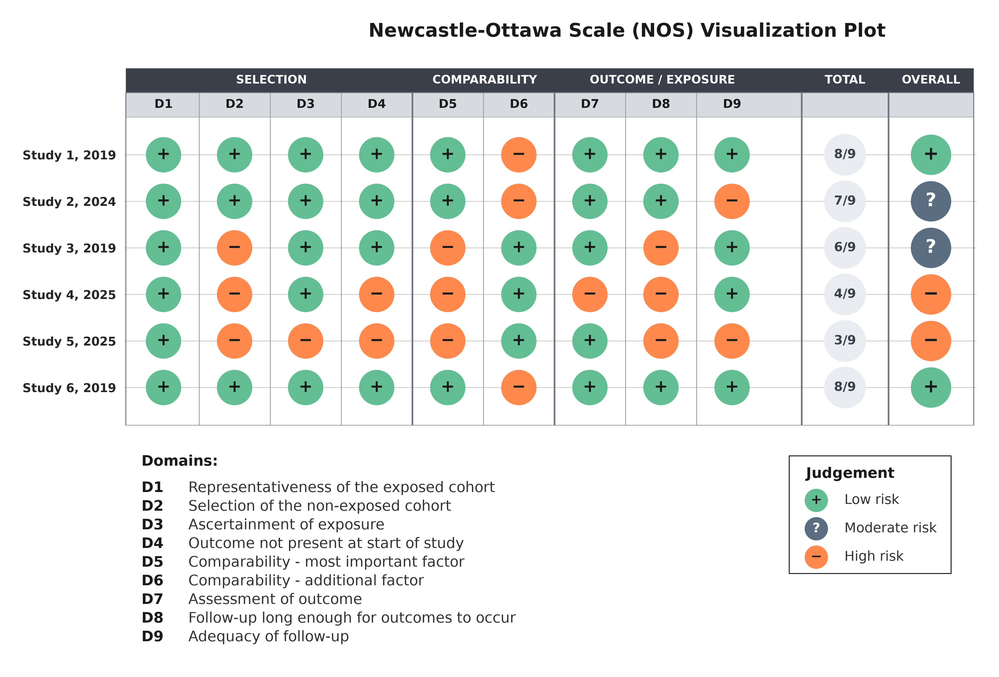
  <figcaption><strong>NOS visualization, <code>"sage"</code> theme</strong> — <code>plot_nos_visualization(..., theme = "sage")</code>.</figcaption>
</figure>

The full theme list is <code>"traffic_light"</code>, <code>"gray"</code>,
<code>"ocean"</code> and <code>"sage"</code> — see
[Themes and output formats](#themes-and-output-formats).

## Citation

If you use the plots in a publication, the **preferred citation** is the
NOS-TLPlot metapaper:

> Sahu, V. (2026). *NOS-TLPlot: A Specialized Python Tool for Visualizing
> Newcastle-Ottawa Scale Risk-of-Bias Assessments*. Journal of Open Research
> Software, 14(1), 7. <https://doi.org/10.5334/jors.635>

```bibtex
@article{sahu2026jors,
  author = {Sahu, Vihaan},
  title = {NOS-TLPlot: A Specialized Python Tool for Visualizing Newcastle-Ottawa Scale Risk-of-Bias Assessments},
  journal = {Journal of Open Research Software},
  volume = {14},
  number = {1},
  pages = {7},
  year = {2026},
  doi = {10.5334/jors.635},
  url = {https://doi.org/10.5334/jors.635}
}
```

If you want to cite the code specifically, cite the NOS-TLPlot software:

> Sahu, V. (2026). *NOS-TLPlot: Visualization Tool for Newcastle-Ottawa
> Scale in Meta-Analysis* (v3.0.2). Zenodo.
> <https://doi.org/10.5281/zenodo.24380517>

```bibtex
@software{sahu2026nostlplot,
  author = {Sahu, Vihaan},
  title = {NOS-TLPlot: Visualization Tool for Newcastle-Ottawa Scale in Meta-Analysis},
  year = {2026},
  note = {Version 3.0.2},
  doi = {10.5281/zenodo.24380517},
  url = {https://doi.org/10.5281/zenodo.24380517}
}
```

and, optionally, the R interface itself:

> Sahu, V. (2026). *nos.tlplotR: Visualize Newcastle-Ottawa Scale
> Risk-of-Bias Assessments with 'nos-tlplot'* (v0.2.0).
> <https://github.com/nos-tlplot/nos.tlplotR>

```bibtex
@software{sahu2026nostlplotr,
  author = {Sahu, Vihaan},
  title = {nos.tlplotR: Visualize Newcastle-Ottawa Scale Risk-of-Bias Assessments with 'nos-tlplot'},
  year = {2026},
  version = {0.2.0},
  url = {https://github.com/nos-tlplot/nos.tlplotR}
}
```

`citation("nos.tlplotR")` returns these citations, and the package citation
metadata is available at
<https://github.com/nos-tlplot/nos.tlplotR/blob/main/CITATION.cff>.

## Related links

* NOS-TLPlot website: <https://nos-tlplot.github.io>
* Python package on PyPI: <https://pypi.org/project/nos-tlplot/>
* Python package repository: <https://github.com/nos-tlplot/NOS-TLPlot-Package>
* Main NOS-TLPlot repository: <https://github.com/aurumz-rgb/NOS-TLPlot>
* R package repository: <https://github.com/nos-tlplot/nos.tlplotR>
* reticulate documentation: <https://rstudio.github.io/reticulate/>

## License

Apache License 2.0: <https://github.com/nos-tlplot/nos.tlplotR/blob/main/LICENSE.md>.
